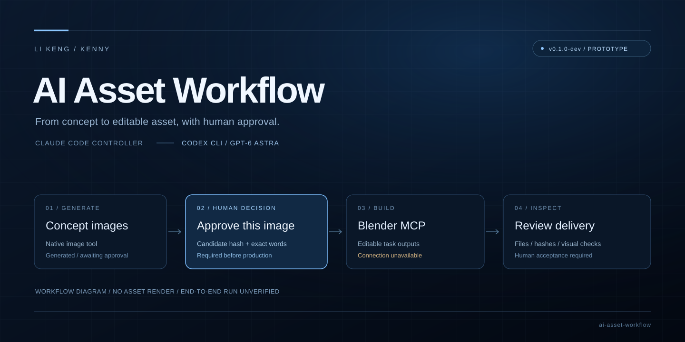

<p align="center"></p>

# ai-asset-workflow

**我定方向，Agent 协同制作。** 我与 Claude Code 沟通，由它拆解任务、统筹 Codex CLI 和制作工具。先批量生成候选图片，经我确认后，再通过 Codex 与 MCP 将制作任务交给 Blender，最后由我检查成品。

**v0.1.0-dev · 原型开发中 · 作者 Li Keng / Kenny。** 本仓库提供 Python 标准库 CLI、控制器指引与技能入口。封面是代码绘制的流程示意。

## 当前支持与证据

| 能力 | 当前情况 | 边界 |
| --- | --- | --- |
| Python 标准库工作流 CLI | 核心已实现 | 初始化、候选登记、审批、阶段调度与结果管理 |
| Codex CLI 原生图像工具 | 经任务提示词运行的原生 worker 已实测，退出码 0 | 使用现有登录与工具权限，无需另填 API key |
| 三件套概念设计 | 三图均已真实生成并查看 | `equipment-case`、`inspection-lamp`、`control-console` **均未获用户批准，暂不公开** |
| `generate-concepts` 封装 | 已实现，合成协议测试通过 | 底层原生 worker 已实测；封装未再次发起真实生图 |
| 图像模型标识 | 实际标识未暴露，记录为 `null` | 不标为 GPT-Image2.6；`gpt-6-astra` 是执行代理标识 |
| Claude Code 控制器 | 指引可由用户的 Claude Code 桌面端加载 | 已提供桌面端项目入口与调度指引；Claude Code 主导的完整链路待验证 |
| Blender MCP | 制作任务包已提供，完整制作未验证 | 执行前需检查实际连接；既有记录没有 Blender 端到端交付结果 |
| ComfyUI / GPT Image 接入 | 流程设计中的两种生图方式 | v0.1.0-dev 尚未实现 ComfyUI 或独立图像 API 适配器 |

## 工作流设计

以下分工与[作品集网站](https://kkkkkennys.github.io/kenny-ai-art/#ai-workflow)、简历及作品集 PDF 一致。它描述目标流程；当前程序与实测范围见上表。

| 节点 | 负责什么 |
| --- | --- |
| 01 · 我 | 提出需求与创作方向 |
| 02 · Claude Code | 拆解需求，统筹任务 |
| 03 · Codex CLI | 编辑 ComfyUI 批量生图工作流，或调用 GPT Image |
| 04 · ComfyUI / GPT Image | 按设定批量生成候选图片 |
| 05 · 我 | 审核图片，确认风格；不满意则反馈给 Claude Code 调整 |
| 06 · Claude Code | 接收确认，派发三维制作任务 |
| 07 · Codex CLI | 执行三维制作任务 |
| 08 · MCP 连接 | 把任务传给 Blender |
| 09 · Blender | 建模、材质与输出 |
| 10 · 我 | 查看成果，确认交付 |

**已实测的是 Codex 原生生图与候选图片登记。** 上图中的 ComfyUI / GPT Image 接入，以及 Claude Code 主导的完整三维串联仍待验证；现有 CLI 命令使用原生图像工具，不会自动切换到这两个后端。

选择主题不构成图片批准。模型与交付阶段绑定获批参考图的内容哈希；更换参考图需重新审批。

## 快速开始

在仓库根目录使用 Python 运行。CLI 仅依赖标准库；需已有 Codex CLI 与原生图像工具访问权限，制作阶段另需 Blender MCP。以下是新项目流程；已有项目直接查看 `status`：

```powershell
python -m workflow --help
python -m workflow init --brief examples/sci-lab.json --project runs/sci-lab/project.json
python -m workflow status --project runs/sci-lab/project.json
```

生成尚缺概念图的资产，随后打开审阅页。`--codex` 替换为实际可执行文件绝对路径：

```powershell
python -m workflow generate-concepts --project runs/sci-lab/project.json --codex "<codex可执行文件绝对路径>" --model gpt-6-astra --timeout 1200
python -m workflow review --project runs/sci-lab/project.json
```

默认仅生成 `needs_concept` 资产；显式加 `--asset equipment-case` 可请求新变体。已有原生 worker 回执时，用下列导入命令代替重新生成；已有单张图片时使用 `register`：

```powershell
python -m workflow ingest-concepts --project runs/sci-lab/project.json --receipt "<项目私有目录中的实际图像回执路径>"
python -m workflow register --project runs/sci-lab/project.json --asset equipment-case --image "<实际候选图片路径>" --source codex-imagegen --prompt-file "<实际提示词文件路径>"
```

两种登记方式按实际输入选用；没有提示词文件可省略 `--prompt-file`。登记后重新 `review`，打开返回的 `review/index.html` 展示实际图片与方案编号，完整候选哈希从 `status` 读取。

仅在用户看过图片并明确批准后，复制该候选的完整哈希与用户原话执行；占位文字不能作为审批记录：

```powershell
python -m workflow approve --project runs/sci-lab/project.json --asset equipment-case --candidate "<已展示并获批的候选完整哈希>" --decision-note "<用户明确批准该图的逐字原文>"
```

审批且 MCP 连接可用后执行模型阶段。目标为本次任务的新建输出，同一 Blender 工程串行写入：

```powershell
python -m workflow run-codex --project runs/sci-lab/project.json --asset equipment-case --stage model --codex "<codex可执行文件绝对路径>" --model gpt-6-astra --timeout 1200
python -m workflow status --project runs/sci-lab/project.json
```

任务包、回执格式、交付检查、失败重试与最终验收见[控制器指南](docs/controller-guide.md)。

## 状态与验收

| 状态语义 | 可以据此判断什么 |
| --- | --- |
| `needs_concept` / `generating_concept` | 待生成 / 正在生成概念图 |
| `concept_review` | 概念图已生成，待用户审批 |
| `approved` | 选中参考图的哈希已获明确批准 |
| `running` | 某阶段正在执行；尚无成功结论 |
| `model_review` | 建模阶段结果待检查 |
| `delivery_review` | 交付阶段结果待检查与用户验收 |
| `completed` | 检查后已记录用户交付验收 |
| `failed` | 执行失败；排除原因后才可重试 |

进程退出、stdout 或报告中的“完成”不能证明资产成功。产物存在与哈希校验、Blender 内结构检查、实际画面检查、用户验收分别记录。未检查的项目保留为未验证。

## 验证记录

2026-11-07 的既有验证记录：`python -m unittest discover -s tests -v` 共 53 项，51 项通过、2 项因 Windows 文件符号链接权限跳过；目录 junction 检查通过。本次仅同步文档，未重新运行这些测试。它们验证任务状态、审批、哈希、路径、错误与超时处理，不代表 Blender 几何或渲染质量通过。真实原生生图 worker 已生成三张设计图并完成图像登记。详细边界见 [验证记录](docs/validation.md)。

## 文档与依赖

- [控制器指南](docs/controller-guide.md)：全部 CLI 命令、人工审批与恢复流程。
- [架构与证据边界](docs/architecture.md)：角色、状态、哈希绑定、串行访问与交付规则。
- [仓库技能入口](skills/ai-asset-workflow/SKILL.md)：由用户要求代理加载；保持仓库相对路径完整。
- [Claude Code 仓库指引](CLAUDE.md)：控制器的运行边界与操作入口。
- 外部 Skill 依赖：[blender-asset-pipeline](https://github.com/KKKKKennys/blender-asset-pipeline)、[camera-shot-library](https://github.com/KKKKKennys/camera-shot-library)。仅链接原仓库，按任务需要读取；本仓库未复制其内容，也不代其声明许可证。相机库用于需要镜头与展示的任务，不是每次建模的前置执行步骤。

## 发布与许可

代码采用 [MIT License](LICENSE)，版权作者为 **Li Keng / Kenny**。生成图片、用户提供的参考图、模型、贴图和第三方素材的授权单独记录，不因进入本流程而自动取得 MIT 授权。

图片审批前只发布可移植 brief、文档与脚本；本仓库的代码绘制封面属于文档包装。`runs/`、日志、本地路径记录、凭据与制作产物默认保持私有，见 [.gitignore](.gitignore)。**制作审批不等于公开发布或素材再授权**；公开任何图片或资产前，还需核对发布授权与来源。
